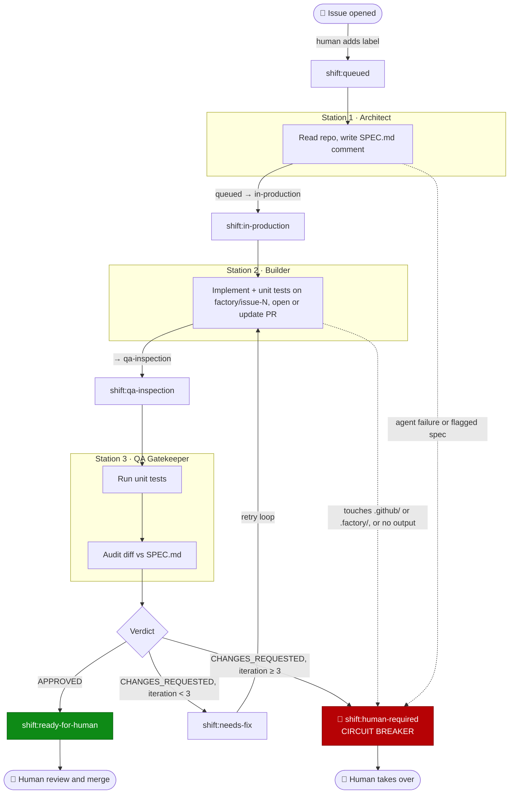

# 🏭 Dark Factory PoC

> *"Lights-out software engineering on GitHub. Issues go in, tested PRs come out."*

A proof of concept for an autonomous software pipeline built **entirely on
GitHub primitives**:

| Factory concept | GitHub primitive |
|---|---|
| Raw material | **Issues** |
| Conveyor belt | **Labels** (`shift:*`) |
| Stations & robots | **Actions** workflows running specialized AI agents |
| Finished goods | **Pull Requests** — tested, reviewed, and *never* auto-merged |

Three agents work the line: an **Architect** writes the spec, a **Builder**
implements it with tests, and a **QA Gatekeeper** audits the result. A circuit
breaker hands anything risky or stuck to a human.

## The assembly line



### Label state machine

| Label | Meaning | Set by | Next station |
|---|---|---|---|
| `shift:queued` | Raw material waiting | Human | 01 Architect |
| `shift:in-production` | Spec ready | Architect | 02 Builder |
| `shift:qa-inspection` | PR awaiting audit | Builder | 03 QA |
| `shift:needs-fix` | QA bounced the PR | QA | 02 Builder |
| `shift:ready-for-human` | QA approved | QA | 👤 |
| `shift:human-required` | **Circuit breaker** | Any station | 👤 |

Each workflow reacts to exactly one label event, which makes the pipeline a
loop-safe state machine. Full guardrails: [`.factory/FACTORY_RULES.md`](.factory/FACTORY_RULES.md).

## Repository layout

```
.factory/
  FACTORY_RULES.md        guardrails (retry cap, escalation, no main push, metrics)
  metrics.json            per-run cost/token log + summary
  prompts/                architect.md · builder.md · qa-reviewer.md
  scripts/                run_agent.sh · guard_paths.sh · escalate.sh · commit_and_push.sh · log_metrics.py
.github/workflows/
  00-init-labels.yml      one-time label provisioning
  01-architect-spec.yml   Station 1
  02-builder-code.yml     Station 2
  03-qa-gatekeeper.yml    Station 3
src/factory_lib/          starter library the factory operates on
tests/                    starter tests
```

## Factory Floor Metrics

Updated automatically from [`.factory/metrics.json`](.factory/metrics.json) as
factory PRs are merged. *(Placeholder values until the first shift runs.)*

| Metric | Value |
|---|---|
| Issues processed | 0 |
| First-pass approval rate | — |
| Avg. cost per issue (USD) | — |
| Avg. Builder↔QA iterations | — |
| Human escalations | 0 |

## Quickstart — run your first shift

1. **Push this repo to GitHub** (create it empty, add the remote, push `main`).
2. **Add secrets** (Settings → Secrets and variables → Actions):
   - `ANTHROPIC_API_KEY` — for the agents (or swap in `OPENAI_API_KEY`, see the
     *PLUG-IN POINT* comments in the workflows and `.factory/scripts/run_agent.sh`).
   - `FACTORY_PAT` — a fine-grained PAT (or GitHub App token) with
     *Contents, Issues, Pull requests: read/write*. **Required:** label changes
     made with the default `GITHUB_TOKEN` do not trigger the next station.
3. **Allow Actions to create PRs**: Settings → Actions → General →
   *Workflow permissions* → "Allow GitHub Actions to create and approve pull requests".
4. **Protect `main`** (recommended): require PR review, block direct pushes.
5. **Provision labels**: Actions → **00 · Init factory labels** → *Run workflow*.
6. **Open an issue**, e.g.:

   > *Add `truncate(text, max_len)` to `factory_lib` that shortens text and appends `…`.*

7. **Start the shift**: add the label `shift:queued`.
8. Watch the labels move: `queued → in-production → qa-inspection →`
   `ready-for-human` (or `needs-fix` loops, or `human-required`).
9. **Review and merge the PR yourself.** The factory never merges.

### Local sanity check

```bash
python -m pip install -e ".[dev]"
python -m pytest -q
```

## Safety model

- Agents push only to `factory/issue-<n>`; merges are human-only.
- Architect and QA are read-only; the Builder cannot run `git`.
- Changes to `.github/` or `.factory/` trip the circuit breaker.
- Max 3 Builder↔QA iterations, then escalation.
- QA cannot approve a failing test suite (enforced in the workflow, not the prompt).
- Issue and diff text is treated as untrusted data in every prompt.
